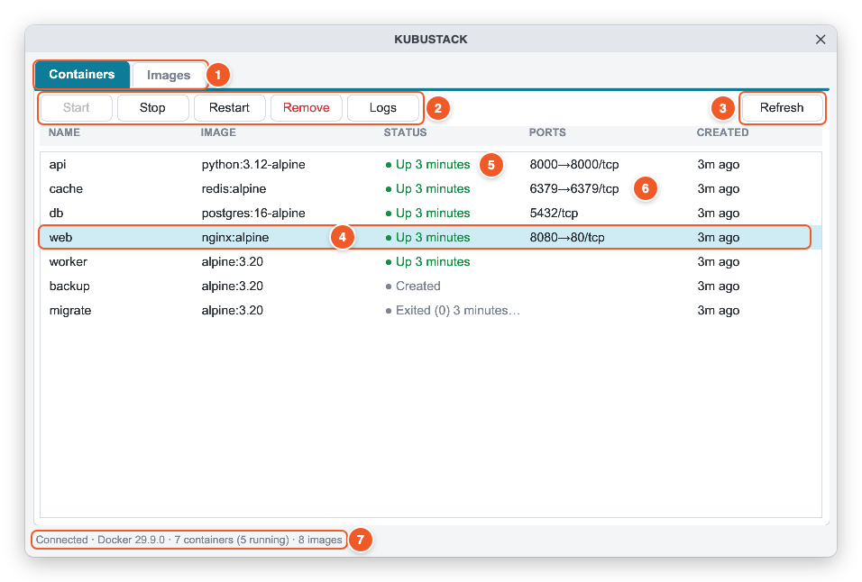
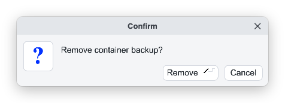
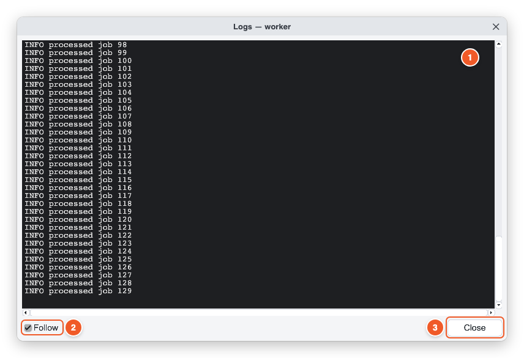
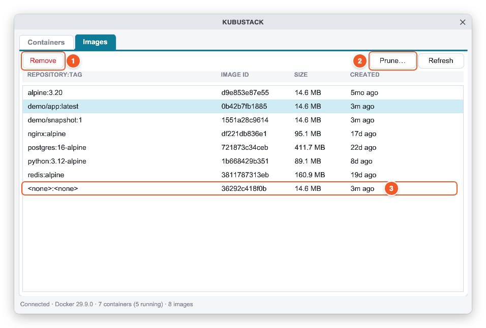
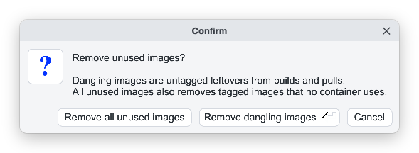
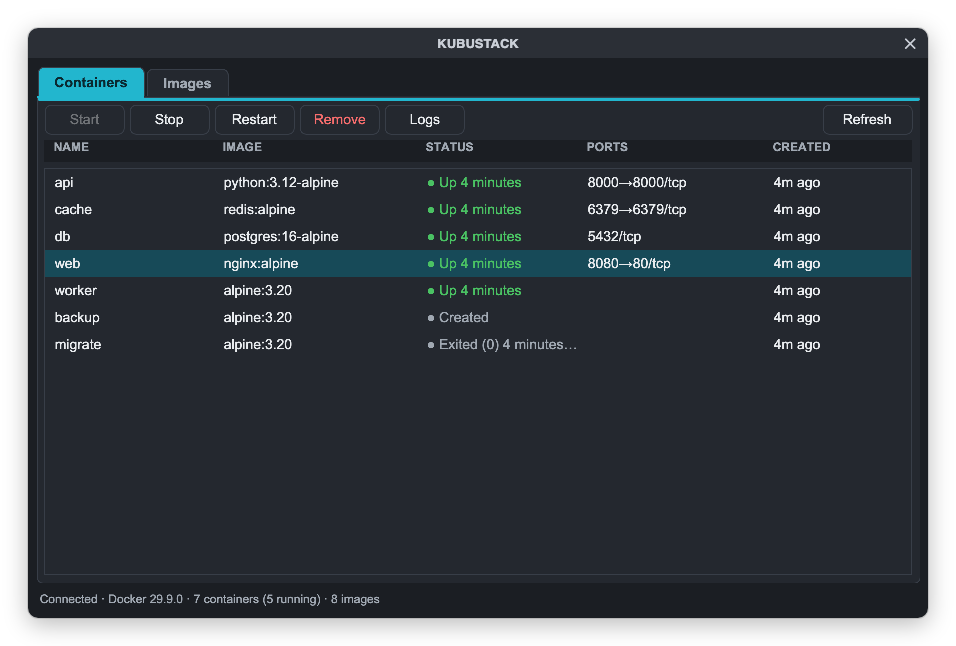
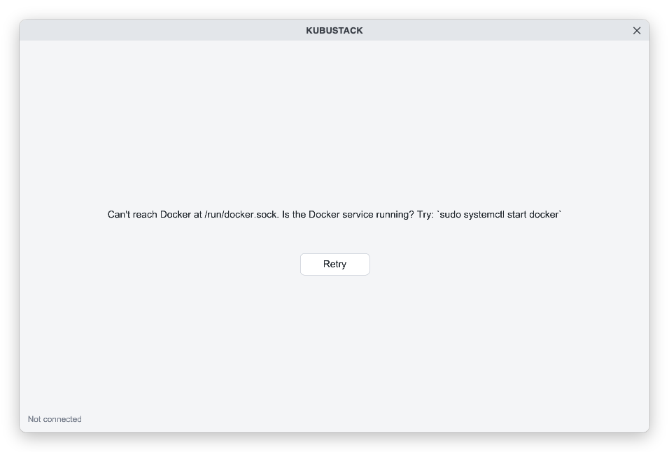

# KUBUSTACK user guide

A quick, picture-by-picture tour. If you haven't installed KUBUSTACK yet, see
[Install](../README.md#install) in the README.

- [1. Start the app](#1-start-the-app)
- [2. The main window](#2-the-main-window)
- [3. Manage containers](#3-manage-containers)
- [4. Read logs](#4-read-logs)
- [5. Manage images](#5-manage-images)
- [6. Live updates](#6-live-updates)
- [7. Light and dark mode](#7-light-and-dark-mode)
- [8. Keyboard shortcuts](#8-keyboard-shortcuts)
- [9. Troubleshooting](#9-troubleshooting)

## 1. Start the app

Open **KUBUSTACK** from your app menu, or run `kubustack` in a terminal. It connects to your
local Docker right away and shows your containers.

If something is wrong (Docker isn't running, or your user can't access it) you'll see a
message with the fix instead. See [Troubleshooting](#9-troubleshooting).

## 2. The main window



1. **Tabs.** Switch between **Containers** and **Images**. The open tab is filled with colour.
2. **Action buttons.** They act on the selected row. Buttons that don't apply are greyed out:
   for example, **Start** is disabled for a container that is already running.
3. **Refresh.** Reloads both lists. You rarely need it, because lists update by themselves
   (see [Live updates](#6-live-updates)). Shortcut: **F5**.
4. **Selected row.** Click a row to select it. The selection stays on the same container even
   when the list reloads.
5. **Status.** A green dot means running; a grey dot means created, stopped or exited.
   Running containers are always listed first.
6. **Ports.** Published ports as `host→container/protocol`, for example `8080→80/tcp`.
7. **Status bar.** Connection, Docker version, and counts. It also shows what just happened,
   like "Stopped web" or why something failed.

## 3. Manage containers

Select a container, then press a button:

| Button | What it does |
|---|---|
| **Start** | Starts a stopped or created container |
| **Stop** | Stops a running container (Docker gives it 10 seconds by default to shut down) |
| **Restart** | Stops and starts a running container |
| **Remove** | Deletes the container, after asking you first |
| **Logs** | Opens its logs (also: double-click the row, or press **Enter**) |

Removing always asks for confirmation:



Press **Remove** (or **Enter**) to confirm, **Cancel** (or **Escape**) to keep it. If the
container is running, the question says so, and confirming stops and removes it in one step.
Removing a container never deletes its image or its volumes.

## 4. Read logs



1. **Log output.** Opens with the last 500 lines. Colour codes from the container are removed
   so the text stays readable. Long sessions keep the latest 5,000 lines.
2. **Follow.** Tick it to stream new lines live as the container writes them; the view
   scrolls to the end. Untick to pause. Follow turns off by itself if the container stops.
3. **Close.** Closes the window and stops streaming.

Each container gets one logs window: opening logs again brings the existing window to the
front. You can keep several containers' logs open side by side.

## 5. Manage images



1. **Remove.** Removes the selected image after asking. If an image has several tags, each
   tag has its own row, and removing a row only removes that tag; the image is deleted with
   its last tag. Docker refuses to remove an image a container still uses, and the status bar
   tells you which.
2. **Prune….** Frees disk space by removing images you don't need (see below).
3. **Untagged images** show as `<none>:<none>` at the bottom. They are usually leftovers
   from rebuilding or re-pulling a tag.

**Prune** asks which kind of cleanup you want:



- **Remove dangling images** (the default, also **Enter**): removes only untagged leftovers.
  This is the safe everyday choice.
- **Remove all unused images:** also removes *tagged* images that no container uses (images
  of stopped containers are kept). You'll need to pull or build them again later.
- **Cancel** (or **Escape**): does nothing.

The status bar then shows how many images were removed and how much space was freed.

## 6. Live updates

KUBUSTACK listens to Docker's event stream, so changes made anywhere (a terminal, a script,
Docker Compose) appear within about a second. Try it:

```bash
docker run -d --name hello nginx:alpine   # appears in the list
docker rm -f hello                        # disappears again
```

There is no polling: while nothing happens, KUBUSTACK uses no CPU. If the event stream drops,
the status bar says "live updates paused" and KUBUSTACK reconnects by itself; **F5** still
refreshes by hand.

## 7. Light and dark mode



KUBUSTACK follows your desktop's dark-mode setting when it starts (GNOME, KDE and Cinnamon,
or any GTK theme with "dark" in its name). After switching your desktop theme, restart
KUBUSTACK. To force a mode:

```bash
KUBUSTACK_THEME=dark kubustack
KUBUSTACK_THEME=light kubustack
```

## 8. Keyboard shortcuts

| Key | Action |
|---|---|
| ↑ / ↓ | Move the selection |
| Enter / double-click | Open logs for the selected container |
| Delete | Remove the selected container or image (asks first) |
| F5 | Refresh both lists |
| Ctrl+Q | Quit |
| Enter / Escape in a dialog | Confirm / cancel |

## 9. Troubleshooting

When KUBUSTACK can't reach Docker, the lists are replaced by a message that says what's wrong
and how to fix it:



Fix the problem, then press **Retry**. If Docker was only restarting, KUBUSTACK usually
reconnects by itself.

| Message | Fix |
|---|---|
| Can't reach Docker | Start Docker: `sudo systemctl start docker` |
| Permission denied | Add yourself to the `docker` group: `sudo usermod -aG docker $USER`, then log out and back in |
| Remote Docker hosts aren't supported yet | `DOCKER_HOST` points to `tcp://` or `ssh://`; unset it or use a `unix://` socket |

From a terminal, `kubustack --check` tests the connection without opening a window.

Rootless Docker and Podman are covered in [Docker access](../README.md#docker-access).
Found a bug? [Open an issue](https://github.com/nixondebantu/kubustack/issues).
